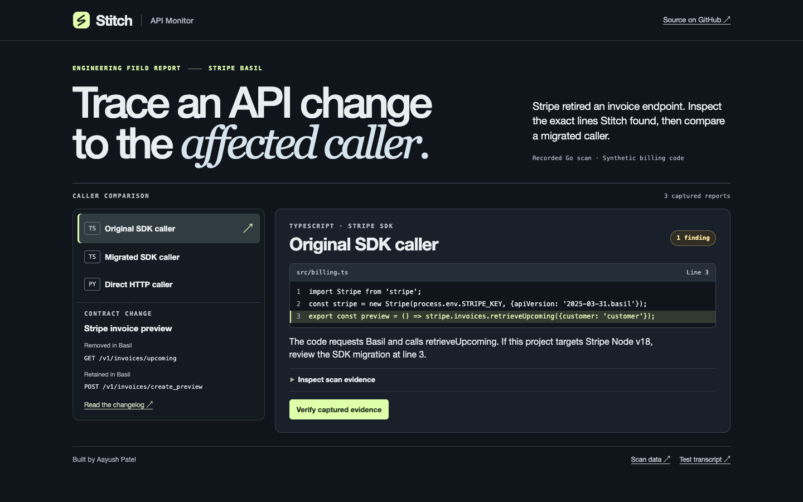

# Stitch API Monitor

Stripe removed the upcoming-invoice endpoint in its Basil release. An engineer maintaining billing still has to answer a smaller question: **which line of our code needs review, and what evidence says so?**

Stitch connects a provider change to a specific caller. This public case study includes the original Go call matcher, a reproducible contract verifier, and three reports captured from the full scanner on synthetic billing code.

**[Explore the interactive report](https://abp2204.github.io/stitch-api-monitor/)** · [Watch the captioned walkthrough](https://abp2204.github.io/stitch-api-monitor/media/stitch-walkthrough.mp4) · [Read the scan evidence](evidence/reports.json)

[](https://abp2204.github.io/stitch-api-monitor/)

## What the scan found

| Synthetic caller | Captured result | What the engineer should do |
| --- | --- | --- |
| TypeScript, line 3: `invoices.retrieveUpcoming` | 1 SDK migration finding | Confirm the installed and target SDK. If moving to Stripe Node v18, review the call and its arguments. |
| TypeScript, line 3: `invoices.createPreview` | 0 findings for this rule | This method is present in both pinned SDK snapshots. Verify the business flow with integration tests. |
| Python, line 2: `GET /v1/invoices/upcoming` | 1 HTTP migration finding | The request explicitly specifies Basil, whose pinned OpenAPI document omits the endpoint. Review the replacement route and payload. |

Both the configured API version and the SDK version matter. The fixture's constructor establishes the former. Its installed SDK and deployed behavior remain unknown. Stripe's guidance and the pinned specifications supply the provider side of the comparison. [Stripe changelog](https://docs.stripe.com/changelog/basil/2025-03-31/invoice-preview-api-deprecations) · [Stripe Node v18 migration guide](https://github.com/stripe/stripe-node/wiki/Migration-guide-for-v18)

## Run the matcher

The Go module has no external dependencies. From the repository root with Go 1.23 or newer:

```sh
go test ./...
go run ./cmd/inspect fixtures/billing-before.ts
go run ./cmd/inspect fixtures/billing-after.ts
```

The first command-line inspection prints:

```json
[
  {
    "line": 3,
    "excerpt": "stripe.invoices.retrieveUpcoming({customer: 'customer'})",
    "boundReceiver": true
  }
]
```

Pass a local JavaScript or TypeScript file to locate either invoice method. The matcher reads text and returns a line, an excerpt and whether it recognized a direct Stripe receiver. Report generation in the full service additionally evaluates source scope, version evidence and migration policy. The Python case is included as a captured full-service result.

## Explore the report locally

```sh
python3 -m http.server 8000 --bind 127.0.0.1
```

Open **http://localhost:8000**. Choose the original caller, inspect its evidence, and compare the migrated caller. **Verify captured evidence** recomputes the selected source and registry hashes, checks the cited line and checks the endpoint's presence in the contract snapshots. The browser replays recorded results offline after the local files have loaded. No account, API key or customer repository is required.

## How it works

1. **Qualify the contract.** The Go catalog pins the exact bytes of two Stripe OpenAPI specifications. Its derivation records operation presence, path references and parameter context. The old GET path disappears in Basil. The replacement POST path appears in both snapshots. [Catalog implementation](catalog/catalog.go)
2. **Find a caller.** The lexical matcher ignores comments and code-like strings. It retains source offsets and checks whether a direct invoice call belongs to a recognizable Stripe client. Dynamic receivers can remain candidates. [Matcher](inspection/lexical.go) · [Cross-check against captured results](inspection/inspect_test.go)
3. **Report what can be established.** For the full-service capture, the Go importer read synthetic GitHub responses, a worker analyzed them, and PostgreSQL stored the results. The test read the reports through a locally signed HTTP request. Its negative controls left unknown-version, unrecognized-version, unsupported-language and oversized cases partial. The scan made no live issue or billing calls. [Seven-case scan transcript](evidence/scan-test.txt)

## Provenance and verification

On **November 20, 2026**, the full-service capture ran on Stitch integration revision `44c3a876919bdb7b04213823e895f89a64579bdc` using its unchanged `TestScanProducerEndToEnd` suite and a disposable PostgreSQL instance. The public JSON retains selected fields from the three completed responses and the SHA-256 digest of each original response. Runtime IDs and synthetic GitHub links were omitted. The web UI, export format and CLI wrapper were written for this showcase.

The public Go module includes the original `codeTokens` and `callUsages` functions and the Stripe invoice catalog implementation from that revision. The inspector tests compare the public matcher’s output with the full-service captures. The catalog was also regenerated byte-for-byte from both pinned public Stripe specifications. To repeat that optional check, save both files identified by [the source pins](catalog/verify.go) and run:

```sh
CATALOG_REGENERATE=1 \
CATALOG_ACACIA_PATH=/path/to/acacia-spec3.json \
CATALOG_BASIL_PATH=/path/to/basil-spec3.json \
go test ./catalog -run TestCatalogRegeneratePinnedOriginals -count=1 -v
```

The three trace examples document static migration evidence. They make no claim about production failures, customer adoption, or coverage across all Stripe operations.
